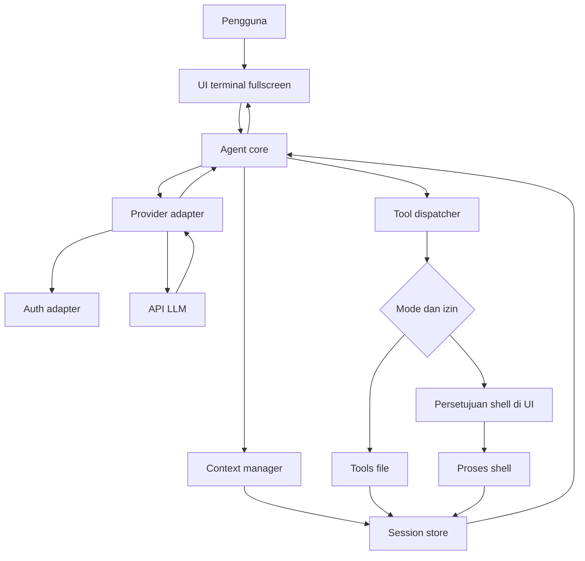
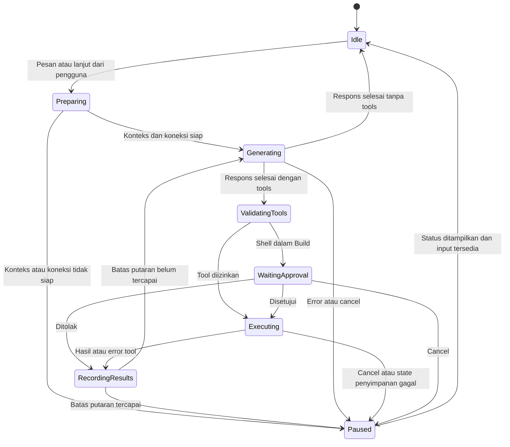

# Arsitektur Sistem ruvx v1

ruvx memakai satu proses aplikasi dengan pemisahan tanggung jawab antara terminal, agent, kebijakan tools, koneksi provider, dan penyimpanan. Pemisahan ini merupakan batas modul internal; v1 tidak memerlukan server atau protokol antarproses untuk bekerja.

## Komponen dan batas tanggung jawab

| Komponen | Tanggung jawab | Tidak menjadi tanggung jawabnya |
| --- | --- | --- |
| CLI bootstrap | Memilih workspace, membaca config, membuka sesi, menginisialisasi terminal | Menjalankan pekerjaan model sebelum UI siap |
| Terminal UI | Input, fullscreen transcript, source-offset selection, clipboard, review/approval, status, dan dispatch intent pengguna | Menulis file proyek atau memutuskan izin tools |
| Agent core | Menyusun request, mengelola run/turn, mengurutkan tool calls, menentukan kondisi berhenti | Mengetahui detail OAuth atau format SSE provider |
| Context manager | Memilih pesan aktif, instruksi, referensi file, dan hasil compaction | Menghapus riwayat atau merangkum otomatis |
| Provider adapters | Serialisasi request, decoding streaming, normalisasi hasil, dan capability validation | Menjalankan tools lokal |
| Auth adapters | API key, identitas OAuth, validasi token, refresh, dan readiness koneksi | Memilih provider pengganti saat gagal |
| Tool dispatcher | Memvalidasi nama/argumen/mode, meminta approval, dan mengatur eksekusi | Memercayai label mode dari output model |
| Tool executors | List/search/read/patch/shell sesuai kontrak | Melewati batas workspace atau approval dispatcher |
| Session store | Jurnal, materialisasi state, baseline diff, artefak hasil tool, dan locking | Menjalankan ulang tindakan saat resume |
| Config store | Default dan konfigurasi pengguna; referensi profil | Menyimpan token di transcript |

## Aliran data

Auth menyediakan kredensial ke adapter melalui antarmuka privat. Token tidak dimasukkan ke event UI umum, pesan model, tool arguments, atau jurnal sesi.

## Model eksekusi

Default teknis adalah runtime asinkron Tokio, HTTP client Reqwest dengan TLS Rustls, dan Ratatui/Crossterm untuk terminal. Versi dependency dipastikan saat implementasi dimulai; versi dokumentasi yang telah diteliti tercatat di [sumber](10-research-and-sources.md).

Satu task menjadi pemilik keluaran terminal. Worker network, pencarian yang berat, penyimpanan, serta proses shell mengirim event melalui channel berbatas. Operasi yang memblokir dipindahkan dari loop input/render. UI tetap dapat membatalkan pekerjaan saat provider atau shell lambat.

Satu session memiliki maksimal satu run aktif. Satu workspace kanonis memiliki satu writer aktif agar dua proses ruvx tidak saling menimpa perubahan. Workspace berbeda boleh dipakai bersamaan; refresh token untuk identitas yang sama memiliki lock tersendiri.

Tool calls dari satu respons dijalankan berurutan untuk v1, termasuk ketika provider mengirimkannya secara paralel. Urutan ini membuat edit, baseline diff, hasil tool, dan approval dapat dipahami tanpa menambah scheduler perubahan file.

## Kontrak intent dan event

Nama berikut adalah kontrak konseptual, belum berupa tipe Rust yang diimplementasikan.

| Arah | Kelompok | Data minimum |
| --- | --- | --- |
| UI → core | Submit, Continue | Session, pesan pengguna atau pilihan lanjut |
| UI → core | ChangeMode, SelectModel | Nilai tujuan; hanya diterima ketika idle |
| UI → core | ApproveShell, DenyShell | ID approval dan keputusan, terikat argumen yang ditampilkan |
| UI → core | Cancel, Exit | Run aktif dan alasan bila ada |
| Provider → core | TextDelta | Run/turn, segmen teks |
| Provider → core | ToolCallDelta | Identitas item/call, fragmen argumen; belum boleh dieksekusi |
| Provider → core | TurnCompleted | Respons final valid, calls lengkap, usage jika tersedia |
| Provider → core | TurnFailed | Kategori kegagalan, apakah ada keluaran parsial |
| Core → UI/store | RunStateChanged | Session/run, state baru, alasan berhenti |
| Dispatcher → UI | ApprovalRequested | Command, cwd, timeout, ID approval |
| Executor → core/store | ToolStarted, ToolFinished | ID call, parameter aman, hasil/status dan referensi artefak |
| Context → store | CompactionCreated | Cakupan pesan sumber, ringkasan, pilihan model, versi konteks |

Event yang mengubah state jurnal memiliki nomor urut session, timestamp UTC, session ID, run ID bila relevan, dan identitas event. Delta streaming untuk menggambar layar boleh bersifat sementara; respons lengkap atau status terputus tetap dicatat.

## State machine

Selesai tanpa tool menutup run. Kegagalan tool biasa menghasilkan tool result terstruktur yang dapat dibaca model pada putaran berikutnya. Kegagalan provider, konteks penuh, atau penyimpanan yang membuat pencatatan tindakan tidak dapat dipercaya menghentikan run untuk tindakan pengguna.

## Batas Plan dan Build

Daftar tools yang ditawarkan ke model mengikuti mode, dan dispatcher memeriksa mode kembali sebelum eksekusi. Perubahan mode hanya diterima dari intent pengguna saat idle. Model tidak dapat mengubah mode lewat teks, tool call, AGENTS.md, atau hasil shell.

Plan melarang mutasi proyek dan shell. Penulisan state aplikasi seperti autosave percakapan, login, dan pengaturan pengguna tetap berjalan; itu bukan tindakan model terhadap proyek.

## Konsistensi dan pembatalan

Sebelum tindakan mutasi dimulai, intent dan identitas tindakannya harus tersimpan. Sesudahnya, hasil dan baseline terkait dicatat. Crash di antara kedua tahap menghasilkan tindakan berstatus tidak pasti, bukan alasan untuk mengeksekusi ulang.

Cancel menutup stream aktif dan menghentikan proses shell beserta process group-nya. Hasil tool yang sudah selesai tetap sah. ruvx tidak menjanjikan rollback terhadap perintah atau perubahan yang sudah terjadi. Lihat [kontrak tools](05-agent-tools-and-controls.md) dan [pemulihan sesi](06-context-and-sessions.md).

## Pengendalian penggunaan memori

Riwayat lengkap dan keluaran panjang disimpan ke disk. UI dan core hanya memegang konteks aktif, tail keluaran, dan metadata yang dibutuhkan. Queue event dibatasi; delta teks dapat digabung sebelum redraw. Buffer parsing SSE dibatasi dan kegagalan ukuran memberi error terarah, bukan alokasi tanpa batas.

Pengukuran session besar dipisahkan dari baseline idle. Seluruh ini merupakan strategi untuk mencapai target resource, bukan bukti bahwa target sudah terpenuhi.

## Dokumen tampilan dan preflight

UI memakai peran User/Assistant/Tool/System yang eksplisit. Sumber teks dan draft besar berbasis file privat; dokumen edit menyimpan referensi potongan sumber dan buffer tambahan. Indeks baris bersifat jarang dan dibangun bertahap. Riwayat input menyimpan snapshot referensi.

Preflight menerima snapshot/revisi draft, menyiapkan attachment dan memeriksa konteks di worker sebelum request. Hasil revisi lama dibuang. Pesan yang lolos diteruskan sebagai prepared message agar attachment tidak diperluas dua kali; teks user dan protokol provider tetap memakai isi lengkap. Usage dikirim sebagai event metadata tersendiri, tanpa JSON mentah di alur percakapan.
