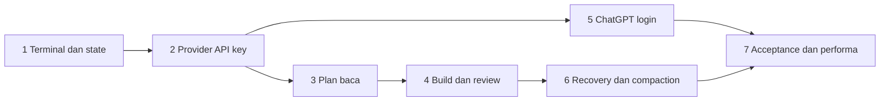

# Roadmap Implementasi ruvx v1

Roadmap ini mengurutkan pekerjaan aplikasi setelah tahap dokumentasi. Urutan memprioritaskan alur lengkap yang dapat diuji, kemudian menambahkan ketahanan dan pembuktian resource. Source v1 kini tersedia; hasil pelaksanaan dicatat pada [laporan verifikasi](../validation-v1.md), sementara gerbang di bawah tetap menjadi kriteria penerimaan.

## Status pekerjaan

| Tahap | Status saat dokumentasi ditulis |
| --- | --- |
| Dokumentasi rancangan | Disusun dalam folder ini; diperiksa konsistensi dan tautannya |
| Fondasi Rust dan dependencies | Tersedia; versi dependency dikunci dalam Cargo.lock |
| UI, agent, tools, provider, auth | Tersedia; lihat source dan pengujian lokal |
| Pengujian aplikasi dan provider live | Pengujian lokal/mock tersedia; akun/provider nyata belum diuji |
| Benchmark resource | Hasil build rilis dilaporkan terpisah pada laporan verifikasi |

## Tahap 1 Fondasi terminal dan state lokal

Bangun single binary Rust dengan pemisahan modul yang dijelaskan di [arsitektur](02-system-architecture.md). Tambahkan argumen workspace/resume/help/version, validasi config, locking, event loop, serta terminal fullscreen. Pin dependencies yang sudah diperiksa pada saat implementasi; jangan menggunakan contoh API dari versi library yang berbeda tanpa verifikasi.

Hasil tahap: composer, shortcut, transcript scroll, status Plan, command lokal dasar, error startup yang jelas, serta jurnal session minimum. Belum perlu request LLM untuk menguji input dan lifecycle terminal.

Gerbang kelulusan: terminal pulih pada exit/error/panic, paste multiline tidak mengirim otomatis, resize/Unicode bekerja, config salah tidak membocorkan nilai privat, dan session lokal dapat dibuka tanpa network. Ukur startup/binary awal sebagai baseline, bukan janji final.

## Tahap 2 Provider wire dan auth API key

Bangun kontrak provider/auth terpisah dengan adapter Responses dan Chat Completions. Mulai dari mock SSE untuk decoder, completion, tool-call assembly, cancel, dan error. Tambahkan profil API key saved/environment serta custom endpoint dengan model eksplisit.

Hasil tahap: `/connect`, `/model`, streaming percakapan, usage bila ada, serta readiness/capability error. Model discovery berlangsung setelah UI siap. API-compatible tidak dianggap otomatis cocok hanya karena chat teks berhasil.

Gerbang kelulusan: WIRE-01–04 dan AUTH-01 lulus; stream terputus tidak menghasilkan tool execution; tidak ada auto fallback profil. Uji satu OpenAI API profile dan satu endpoint kompatibel dengan model tools pada lingkungan pengujian yang disetujui saat itu.

## Tahap 3 Plan dengan tools baca

Tambahkan dispatcher serta list/search/read, instruksi AGENTS.md berscope direktori, referensi file, paging/truncation, dan konteks sesuai kebutuhan. Terapkan larangan tools mutasi di dua tempat: tool advertisement dan dispatcher.

Hasil tahap: agent dapat menelusuri repo dan menyusun rencana yang tersimpan. Session baru Plan; tidak ada shell investigasi yang dipakai sebagai jalan pintas.

Gerbang kelulusan: CTRL-01/02, CTX-01/02, dan uji path/symlink/batas data lulus. Percobaan memanggil tool terlarang langsung tetap ditolak walaupun model mengirim nama yang valid secara JSON.

## Tahap 4 Build, shell approval, dan review

Tambahkan perpindahan mode eksplisit, patch satu file dengan prasyarat versi, baseline diff, shell non-interaktif, snapshot review shell, approval per command, timeout, serta penghentian process group. Catat intent sebelum mutasi dan hasil setelahnya.

Hasil tahap: alur Plan → pengguna memilih Build → penerapan → validasi → ringkasan/diff berjalan lengkap. Counter putaran mengikuti default 30 dan unlimited 0; `/continue` tidak melewati approval.

Gerbang kelulusan: CTRL-03–06 dan DIFF-01–04 lulus; command yang ditolak tidak spawn; konflik editor tidak tertimpa; cancel menghentikan process group; hasil validasi ditampilkan sesuai eksekusi nyata.

## Tahap 5 Login ChatGPT

Implementasikan jalur resmi Sign in with ChatGPT yang telah diverifikasi ulang terhadap dokumen saat implementasi. Tambahkan browser/loopback, validasi OAuth/OIDC, issued client registration, token scope gate, protected storage, dan refresh lock lintas proses. Gunakan capability payload khusus subscription pada adapter Responses.

Hasil tahap: `/connect` OpenAI menawarkan API key atau akun ChatGPT; keduanya tetap memakai core agent yang sama. Runtime Codex/OpenCode tidak ditambahkan sebagai dependensi.

Gerbang kelulusan: AUTH-02–05 lulus melalui mock terarah dan satu akun live yang memenuhi syarat menjalankan tool cycle. Jika akun atau akses preview tidak tersedia, tandai tahap belum terbukti; jangan mengklaim subscription selesai berdasarkan mock atau login identitas saja.

## Tahap 6 Resume, compaction manual, dan recovery

Lengkapi journal materialization, artefak panjang, baseline hasil, identifikasi tindakan uncertain, pemulihan tail JSONL, serta perpindahan profil/model. Implementasikan `/compact` manual tanpa menghapus riwayat asli dan tanpa memotong history otomatis saat penuh.

Hasil tahap: session dapat dilanjutkan secara aman terhadap replay tindakan, termasuk setelah crash. Full history tetap di disk; UI hanya memuat data yang diperlukan. Error disk menghentikan mutasi baru.

Gerbang kelulusan: CTX-03–05 dan STATE-01–05 lulus. Resume tidak mengirim request otomatis, uncertain shell tidak dieksekusi ulang, serta compaction gagal/cancel mempertahankan konteks sebelumnya.

Penyimpanan minimum sudah ada sejak tahap 1. Tahap ini memperluas cakupan recovery; bukan alasan menunda pencatatan mutasi pada tahap 4.

## Tahap 7 Acceptance dan performa

Jalankan FLOW-01 dan FLOW-02 dengan bukti mode, approval, perubahan, serta hasil validasi. Lakukan PTY matrix macOS/Linux, pengujian koneksi aktual, dan pengukuran release build sesuai PERF-01–04.

Hasil tahap: laporan pengujian yang merujuk kebutuhan dan versi build; batas preview/account tercatat; angka startup/RAM/binary benar-benar diukur. Optimasi hanya dilakukan pada bottleneck yang teramati dan diuji ulang pada metrik yang dipengaruhi.

Gerbang kelulusan: seluruh REQ memiliki bukti penerimaan, tidak ada tool yang melewati mode/approval, dua workflow berhasil, terminal pulih, dan target resource tercapai pada baseline kedua platform.

## Dependensi utama

## Risiko teknis dan respons

| Risiko | Respons rancangan | Bukti yang dibutuhkan |
| --- | --- | --- |
| SIWC preview berubah atau akun tidak memenuhi syarat | Verifikasi ulang route/capability; pertahankan API-key path; laporkan status subscription sebenarnya | AUTH live dan sumber terbaru |
| Endpoint compatible berbeda perilaku | Adapter terpisah, capability eksplisit, tidak silent fallback | Fixture wire dan live endpoint |
| Streaming/reflow menggeser seleksi | Offset sumber stabil, transcript lazy, satu renderer | TTY-01/02/08 |
| Snapshot shell mahal | Spool disk, batasi cakupan teks, kecualikan deps/build, ukur operasi terpisah | DIFF-04 dan PERF-04 |
| Crash di antara mutasi dan penyimpanan hasil | Intent durable, hasil uncertain, tanpa replay otomatis | STATE-02 |
| Sesi panjang menghabiskan RAM/konteks | Artefak disk, pembacaan terbatas, compaction manual | CTX-03/04 dan PERF-04 |
| Besar binary melampaui target | Audit release profile dan dependency tree berdasarkan ukuran terukur | PERF-03 |

## Pekerjaan setelah v1

MCP, skills, native Anthropic/Gemini, subagent, headless, undo, serta Windows tetap merupakan kandidat terpisah. Tidak menambahkan hook atau sistem plugin generik semata-mata untuk kemungkinan kebutuhan tersebut. Perluasan baru harus mempunyai kebutuhan, kontrak, dan kriteria penerimaan sendiri.

## Penyelesaian tahap dokumentasi

Folder rancangan lengkap ketika semua file pada [indeks](README.md) tersedia, seluruh keputusan pengguna dapat ditelusuri, tautan lokal valid, dan roadmap tidak diberi status sudah diimplementasikan. Tidak diperlukan Cargo project, dependency download, login, panggilan inference, atau benchmark untuk menuntaskan tahap ini.
